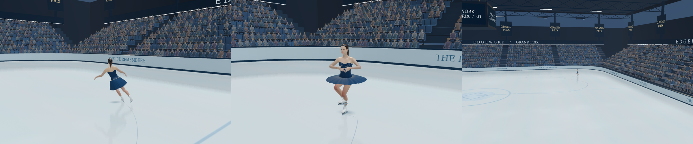
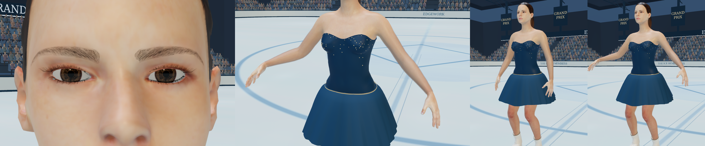

# Edgework

**A physics-first figure skating game.**
*The ice remembers every line.*

Every metre of travel is the consequence of lean, pressure and edge choice, and every edge
you take is written into the ice beneath you. There is no jump button: a jump is an entry
edge, a loaded knee and a release, and the solver decides what happens next.

---

> **Picking this up in a later session?** Start with [`Hand_off.md`](Hand_off.md): current state,
> conventions, open decisions, and the things most likely to trip you up.

## Play EDGEWORK: Grand Prix

```sh
npm start
```



*Real renders from the current build. [Watch the same passage in motion](docs/presentation/edgework-now.mp4),
or [compared with where this rebuild started](docs/presentation/start-vs-now.mp4).*



*Close up: the eyes, the costume, then Function arms (left) beside Expression arms (right). In motion:
[blink and gaze](docs/presentation/blink-and-gaze.mp4), [the costume before and after](docs/presentation/costume-before-after.mp4)
and [Function beside Expression](docs/presentation/arm-tiers.mp4).*

Requires Godot 4 (tested with 4.7.2), Node 24.19+ or 26, FFmpeg, and a GPU that runs Godot's
Forward+ renderer (Vulkan or D3D12). No npm packages need installing. The launcher prepares the
simulation and opens **Northlight Arena**.

**The first launch on a graphics card takes about ten seconds.** Godot builds its Vulkan pipeline
cache for your GPU and driver; that cache can't ship with the game. A title screen says so and stays
up until the menu has drawn. After that, it starts in about three seconds
([measurements](docs/performance-visual-review.md#4a-cold-start-re-measured-and-the-boot-screen-2026-11-23)).

### The Linux package

```sh
npm run build:native                                   # builds games/ice-run-godot/exports/linux/
cd games/ice-run-godot/exports/linux && sha256sum -c SHA256SUMS && ./ice-run.x86_64
```

The package needs Node on PATH (or `ICE_RUN_NODE=/path/to/node`) and keeps `bridge/`, `runtime/` and
`ice-run.pck` beside the executable. The export builds into a staging folder and replaces the last good
package only after every check passes, so a failed export leaves the old one intact. Saves, isolated
smoke runs and troubleshooting: [`docs/distribution-linux.md`](docs/distribution-linux.md).

## What's in the game

**What you see is driven by the simulation.** The hips, lean and boot roll come straight from the
solver's state, so a deep edge really rolls the boot over, and drawing the arms in during a spin is the
same event that speeds it up. Arms, the free leg, spin shapes and the motion library are authored; there
is no motion capture.

### Modes

| Mode | What it is |
| --- | --- |
| **Career** | Two seasons, ten events: First ice to the Championship program, then Sectionals, Autumn Trophy, Northern Cup, Nationals and the medallists' gala. Medals by completion and falls; XP and training weeks; scored with ISU-style TES, spin and step levels and program components. |
| **Arcade** | A ladder of rounds against the rivals, with three lives. |
| **Exhibition & Free skate** | Skate for the crowd in any venue, no required elements. |
| **Creation** | Compose a program on the game's music in the Composer, then watch the computer skate it. |
| **Watch a demonstration** | The computer pilot skates with an on-screen controller showing its inputs. |
| **Learn your controls** | Guided lessons (below). |
| **Pairs** and **Pairs challenge** | A partner on the ice, presented and lifted through the same bridge; a 90-second challenge. |
| **Rookie course** and **Ice Run** | Eight gates to learn a line; a 90-second course of lights. |

### The career

- **Six rivals**: Ansa Merrow, Lio Tarrant, Katya Vell, Noor Ashdown, Remi Castellan and Teodora Wynn,
  each with a backstory and a style; five skate on their own model (Lio Tarrant's isn't built yet). Their scores come from the same solver, measured with a scripted
  pilot. Before a program the warm-up group shares the ice; after it come the kiss-and-cry and a podium
  that plays (gold waves, silver holds the flowers).
- **Create a skater** from seven origins (rink rat, gymnast, ballet, hockey, speed skater, roller rink, late
  starter), each a different shape of the same overall, with its own body build, style and dance.
- **Styles**: Power, Finesse, Technician and Endurance, plus a custom style forged from your first season's
  journal. A dance style dresses each event's program.
- **Training**: XP raises stats, and each raise costs a training week. Medals earn weeks; jump families go
  rusty unless drilled; falls wear the body and can injure it, and rest heals it. If you're ever out of weeks
  with the next event locked, any medalled event skated again earns a week of practice.
- **Plans**: reorder an event's elements and add up to two of your own, and set them to the music.
- **Arms**: choose Function, Shared or Expression. Expression earns presentation marks and gives up
  balance; 45-second drills shrink the trade.

### Learning to skate it

- **Trust the ice**: fifteen steps from standing still to a turning jump, in your setup's own words; a ghost
  skater demonstrates the push, the snowplow, the dig and the turning jump.
- **A course for each setup**: Blade Explorer, Simulation, Experimental, Dig Gate and Full Repertoire each
  teach what is particular to their mapping; the Elite paddles have their own.
- **Program elements**: an event's elements in order (pushing glide, edge, crossovers, a half-turn jump, a
  full spin) in the career's own words and judged by the career's own checks.
- **The double loop**: one beat-aligned jump, placed try after try.

### Presentation

- **Athlete**: built on MakeHuman's CC0 anatomy and skin, with a pleated skirt on sprung panels; eyes reach
  a target before the head, and she blinks. **38 costume presets** in collections, **12 skate presets**
  (boots, blades, laces, heels), and an atelier for your own designs.
- **Six venues** around the same sheet of ice, from a practice rink at dawn, a riverside club and a lakeside rink at night to the
  Nationals Coliseum, the exhibition gala and Northlight Arena. The venue changes the room, never the physics.
- **Motion library**: 418 clips (108 falls, 81 expressions, 68 spins, 60 transitions, 29 ceremony clips such as
  bows and the podium, 24 leg lines, 20 idles, 19 footwork steps, 9 recoveries) and 18 dance styles, played over the
  solver's body.
- **Cameras**: Tracking, Broadcast, Rink and Blade, plus a director camera in Unreal. Tracking frames by move.
- **Element cards** read jumps and tricks from the physics, not from the buttons pressed.
- **AI ghost**: a translucent skater shows a lesson's move beside you, from the shared `game/ghost.ts`
  ([contract](docs/ghost-parity.md)).

### Setups and controls

Five setups put the same body under different hands; pick one in Settings and read its description.

| Setup | In short |
| --- | --- |
| **Blade Explorer** | One stick is the skater, RT is the knee (a push bends it for you), balance has help. The way in. |
| **Simulation** | One stick per blade, one trigger per knee, the feet in the hips. Almost no help. |
| **Experimental** | Triggers are legs, thumbs are blades, face buttons only ask. The physics decides. |
| **Dig Gate** | Experimental's body, with the dig timed for you. |
| **Full Repertoire** | A button for every move, balance help and an optional landing coach. |

**Xbox Elite Series 2:** A select, B back, D-pad navigates, Menu pauses, View cycles cameras, F11 fullscreen.
Keep the controller's own paddle profile or pick a native Footwork / Moves preset; with the Elite wired, the game
relaunches itself once so the paddles reach it. Disconnecting pauses the game; landing vibration is optional.
Controller tuning and bindings are in Settings. The hands-on checklist is
[`docs/controller-acceptance-checklist.md`](docs/controller-acceptance-checklist.md).

### Browser game, physics lab and Unreal client

```sh
npm run start:browser        # http://localhost:8123/game/ and the lab at /app/
```

The browser edition shares the solver and the game code; the lab is the instrument the physics is checked in.
A public build is at **<https://9x25dillon.github.io/KoLd__FEEt.ice_skating_/>**. An
[Unreal Engine 5.8 client](games/ice-run-unreal/README.md) draws the same engine through the same local bridge.

## Status

### Verification state

This block is generated. `tools/ice-lab/status.mjs` writes it from what a clean checkout measures,
and CI fails if the committed copy differs by a byte, the same way it does for the
[fidelity report](docs/fidelity-report.md). It holds counts and verdicts only. For the numbers behind
them at a fixed commit, with the command for each, see
[`docs/baseline-281bf8d.md`](docs/baseline-281bf8d.md).

<!-- status:begin (generated by tools/ice-lab/status.mjs — do not edit; CI fails if it differs) -->

| Check | Command | Result |
| --- | --- | --- |
| Ice Lab suite | `cd tools/ice-lab && node --test test/*.test.ts` | 1180 tests: 1179 pass, 0 fail, 1 todo |
| Godot bridge tests | `node --test games/ice-run-godot/tests/*.test.mjs` | 85 tests: 85 pass, 0 fail |
| Unreal contract tests | `node --test games/ice-run-unreal/tests/*.test.mjs` | 11 tests: 9 pass, 0 fail, 2 skipped |
| Replay fixture | `cd tools/ice-lab && node replay/verify.ts test/fixtures/replay-v1.json` | verified, 240 ticks |
| Fidelity validator | `cd tools/ice-lab && node validate.mjs` | 38 cases: 11 pass, 0 fail, 25 unsourced, 2 unmodelled |
| Fidelity gate ([§6.3](docs/fidelity-gate.md#63--the-gate-is-met)) | | **not met** |

Fidelity coverage, external passing cases per class (three are needed in each):

| O1 carve relation | O2 tracing curvature | O3 edge transitions | O4 speed decay | O5 jump rotation | O6 moment of inertia | O7 propulsion |
| ---: | ---: | ---: | ---: | ---: | ---: | ---: |
| 0 / 3 | 0 / 3 | 0 / 3 | 1 / 3 | 4 / 3 | 0 / 3 | 0 / 3 |

External evidence: 5 sourced cases measured outside the project, 5 passing, 0 failing.
Content against corpus: 38 costumes, 6 venues and 12 skate presets (56) to 5 passing external cases.

Tests recorded as failing and left failing (`todo`: they print on every run and do not close the build):
- Ice Lab suite: the review's floor figures hold on every steady case

As CI runs it: no Unreal Engine on the runner, so the two live Unreal checks skip. The Godot smoke test,
the Unreal build, the typecheck and anything on a physical pad are not in this block; see [`Hand_off.md`](Hand_off.md).

<!-- status:end -->

### Where the project is

**Pre-production. One person, no funding,** working with several AI coding agents (Claude Code, Codex,
Qwen Code and Antigravity/Gemini) that hand work to each other through [`Hand_off.md`](Hand_off.md),
review each other's changes, and land nothing without the owner's say-so.

**The gate is fidelity.** Is the model *right*? Does the solver reproduce measurable properties of real
skating (lean against speed and radius, the radius an edge leaves, the speed a held edge loses, air time
and rotation) within stated tolerances? That can be answered by one person, offline, for nothing, so it
comes first. Observables, tolerances and the pass condition: [`docs/fidelity-gate.md`](docs/fidelity-gate.md).
A few external cases pass (jump rotation from Koga et al. 2025, speed decay); most classes have none yet,
so the gate is **not met**.

### Recent work (November 2026)

| When | Work | State |
| --- | --- | --- |
| 6–10 Nov | Unreal client with menus, season, wardrobe and Composer; JPSE jump-entrance search; career styles; clockwise jumps; the free leg's raise; paddles | merged (#72–#82) |
| 11–12 Nov | Season two (Nationals) and the rivals as models; warm-up group; the motion library; backstories, create-a-skater, Arcade, Exhibition, Creation, demonstration | merged (#83–#94) |
| 14–16 Nov | Blade Explorer's push knee; library spins and poses; podium; builds; weight transfer and the support signal (on in Simulation, Experimental, Dig Gate); skates catalogue; 34 new outfits; venues; kiss-and-cry; fidelity baseline, numerical floor and this generated block | merged (#95–#113) |
| 18–20 Nov | Free-foot preparation; beatcross; Nationals pilot; presentation parity; jump over-flight bench; boards gap; `crossPlaceMode` (on in three setups); `comSwayMode` (built, off everywhere); Unreal director camera; double loop lesson | merged (#114–#132) |
| 20 Nov | Video-to-motion blueprint (planning only) | hand-off #132 |
| 22–23 Nov | **Vertical slice** (this branch): Godot 4.7 controller and focus fixes, a 5-minute 1080p benchmark (P99 10.7 ms) and a 347 → 34 ms menu-stall fix, the AI ghost in the native game, a hardened Linux package with checksums; then a cold-start boot screen, a career softlock fix, the Program elements course, and a career balance pass (below) | uncommitted; the slice, boot screen and softlock fix reviewed green by an independent agent (r4, r5); the course, balance pass and this README not yet reviewed |
| 23 Nov | `edgework-video intake`: the first step of the video blueprint, owner-approved, research-only licensing | in progress on `feat/edgework-video` |
| 23 Nov | Stage A of the video blueprint: an `edgework-wireframe/1` reader in Python (with TypeScript parity to 1e-9) and the TypeScript Pose/Clip/Track translator | Python half in PR #133 (open); TypeScript half on `feat/edgework-wireframe` |

**The career balance pass (23 Nov).** A scripted pilot skated every event 21 times. Every event with a
second jump stalled on it: jump rotation follows leg stamina, and the legs barely recover inside a program
([report](docs/reports/career-difficulty-2026-11-23.md)). Owner decisions taken: a jump's required turn now
eases with the legs it took off with (half a turn fresh, never under 0.35); spring now ties edge control and
stamina gains in the overall rating, with the unlock floors re-derived so silver medals still open every event;
season two's routines are being re-measured.

### Open before the next release

- Hands-on Elite 2 acceptance ([checklist](docs/controller-acceptance-checklist.md)) and the owner's
  commit authorization for the vertical slice.
- The first-launch wait itself (about ten seconds, once per GPU and driver).
- The double loop is a narrow, knife-edge result; the fidelity gate; motion capture (none); the native
  solver port (deferred until the model is validated). `KoLdSimCore` is unbuilt and `src/reference/` is
  specification code by design.

### Run the checks

Node 24.19+ or 26, nothing to install:

```sh
cd tools/ice-lab && node --test test/*.test.ts && node app/build.mjs && node app/serve.mjs
node games/ice-run-godot/tools/prepare.mjs --engine-only && node --test games/ice-run-godot/tests/*.test.mjs
godot4 --headless --path games/ice-run-godot -- --smoke-test     # from the repo root
```

Capturing and verifying a replay: the [replay guide](tools/ice-lab/README.md#reproducible-bug-reports).
Where a season stalls: `node games/ice-run-godot/tools/career_difficulty.mjs` (about ten minutes).

### The studio plan

The design bible and the four phase plans — pre-production → vertical slice → production → beta —
describe a **funded studio scenario**: **~$11.9M** over 30 months to launch. They are kept, whole
and unrevised, as the long-horizon target. They are not the current plan. Content volumes in the
production plan stay provisional until the
[W40 recalculation](docs/production-plan.md#8--the-w40-recalculation) replaces them with
measurements from the slice.

**The Unreal runtime is a downstream consumer of the model, and it now exists as a client.**
[`games/ice-run-unreal/`](games/ice-run-unreal/README.md) is an Unreal Engine 5.8 presentation that
talks to the TypeScript solver over the local Node bridge (the owner's choice of 2026-11-03,
"bridge-first"). What stays deferred is a **native port of the solver**: porting it into C++ before
it has been checked against real skating would move unvalidated numbers somewhere slower to correct.

For the current playable rebuild, the operator selected **Godot 4 + Blender on 2026-09-15**,
with the original engine behind a local Node bridge. The older studio scenario retains
**Unreal Engine 5.4+** as its historical engine assumption —
[D2 closed](docs/open-decisions.md#d2--engine) on 2026-09-03 — describes that older studio scenario, not a requirement to undo the Godot build. **Difficulty default: adaptive** —
[D4 closed](docs/open-decisions.md#d4--where-the-difficulty-default-sits) the same day; The Patch
recommends an assist tier from the tracing score it already computes. **Multiplayer:
single-player first** — [D3 closed](docs/open-decisions.md#d3--multiplayer-at-launch) at its
default. **Licensing:** `tools/` is Apache-2.0 —
[D7 closed](docs/open-decisions.md#d7--licence-for-tools) on 2026-09-13.

Two decisions remain open — [D1 budget](docs/open-decisions.md#d1--budget-and-team-size) and
[D5 disciplines](docs/open-decisions.md#d5--disciplines-at-launch) — and they are really one
conversation: if the $18–25M envelope is development-only, the ~$6M of headroom buys exactly the
second discipline D5 asks about. Neither blocks the fidelity work.

---

## Read the design bible

| | |
| --- | --- |
| **📖 Rendered** | [Published document](https://claude.ai/code/artifact/58f6234d-6ece-4f55-8fc5-2b7a7ce86da9) — with diagrams, syntax-highlighted code, light/dark |
| **📄 Markdown** | [`docs/design-bible.md`](docs/design-bible.md) — the reviewable, diffable copy |
| **🧪 Pre-production** | [`docs/pre-production-plan.md`](docs/pre-production-plan.md) · [rendered](https://claude.ai/code/artifact/531a5952-fcfd-44bf-966a-ae31ce3562c9) — 16 weeks, 8 people, and the kill gate |
| **🌀 Level features** | [`docs/level-features.md`](docs/level-features.md) — how spins and step sequences earn levels 1–4 |
| **🧭 Composer solver** | [`docs/composer-solver.md`](docs/composer-solver.md) — planning the skating between elements |
| **🏗 Vertical slice** | [`docs/vertical-slice-plan.md`](docs/vertical-slice-plan.md) · [rendered](https://claude.ai/code/artifact/dde9b2ad-4d31-412f-a15e-6edbb6cc305a) — 24 weeks to the production green-light |
| **🚂 Production** | [`docs/production-plan.md`](docs/production-plan.md) · [rendered](https://claude.ai/code/artifact/6a36f22c-3ed6-4439-828b-cd14759ebaca) — 48 weeks, content trains, the cut list, alpha |
| **🚦 Beta** | [`docs/beta-plan.md`](docs/beta-plan.md) · [rendered](https://claude.ai/code/artifact/bdd4ebbf-b24e-4b31-bcf3-9afdce6a4e53) — 20 weeks, text lock, cert, the ship gate |
| **❓ Open calls** | [`docs/open-decisions.md`](docs/open-decisions.md) — seven decisions that change the shape of the project |

The phase plans are the funded studio scenario described [above](#the-studio-plan).

---

## What is in here

```
games/ice-run-godot/       The native game: Godot 4 scenes and scripts, the Node bridge, export tooling
games/ice-run-unreal/      Unreal Engine 5.8 client on the same bridge
tools/ice-lab/             The engine, the browser game and the lab — see its README
  game/                    Career, lessons, rivals, styles, venues, wardrobe, motion: shared by every client
  sim/                     The solver: pure, deterministic, written to be transcribed to C++
  app/                     The browser rig, build, local server and session collector
  replay/                  Headless replay verification
  test/                    Simulation, gameplay and fidelity regression tests
  native/                  C++17 wire, math and serialization foundation — not a solver
  deploy/                  systemd unit, Caddyfile and runbook for the collector
docs/
  design-bible.md          The full specification — 10 sections, ~14k words
  pre-production-plan.md   16-week feel prototype, playtest protocol, kill gate
  vertical-slice-plan.md   24-week slice, cost model, production green-light gate
  production-plan.md       48-week build: content trains, cut list, alpha gate
  beta-plan.md             20 weeks to cert: text lock, bug curve, ship gate
  level-features.md        Spin and step level detection: declared vs observed
  composer-solver.md       Transition planning: lattice search, time fit, chaining
  open-decisions.md        Decisions D1–D7 + known specification gaps
  fidelity-gate.md         The near-term gate: observables, tolerances, pass condition
  fidelity-report.md       Generated by the validator: the gate's current state
  open-constants.md        Every tuned constant, its level, and what would measure it
  ice-literature.md        What the rink-ice literature measures, and what it means here
  web/                     The five rendered documents (open in any browser)
data/
  scale-of-values.csv      Jump base values and GOE steps
  jump-definitions.csv     Takeoff edge, foot, toe assist, edge-callability per jump
  spin-step-values.csv     Spin and step sequence values by level
  calls-and-deductions.csv Technical panel calls with their simulation thresholds
  segment-rules.csv        Durations, PCS factors, well-balanced program requirements
  spin-positions.json      21 positions: difficulty, pose tolerance, inertia scale
  spin-features.json       11 spin level features and their detection requirements
  step-features.json       Turn taxonomy, variety ladder, step sequence features
  motion-primitives.json   The move vocabulary the transition solver searches over
  entry-templates.json     Per-element required approaches (the solver's goal regions)
  assist-tiers.json        Assist tier parameters and the D4 tracing router
src/reference/
  SkateSolver.cpp          The carve solver — the heart of the game
  JumpResolver.cpp         Load → air → land, with technical-panel rotation accounting
  ScoreCalculator.cs       ISU scoring: base values, nine-judge GOE, PCS, deductions
  SkaterAnimDriver.cpp     Layered animation selection + warping chain
  SpinResolver.cpp         The segment model and spin level-feature detection
  TransitionSolver.cpp     Lattice A*, time fitting, whole-program DP chaining
.github/
  workflows/               Ice Lab checks, native foundation, GitHub Pages deploy
  ISSUE_TEMPLATE/          Bug, play report, tuning session
```

The reference code is **specification as code** — it does not compile, and that is
deliberate. See [`src/reference/README.md`](src/reference/README.md). Where Ice Lab has measured
something the reference got wrong, the correction is recorded in the
[Ice Lab README](tools/ice-lab/README.md#what-it-found).

The scoring data is deliberately **not** in code. The ISU revises its Scale of Values most
seasons, so a rules change should be a data patch shipped in days, not a code release. See
[`data/README.md`](data/README.md).

---

## The short version

**Three pillars.**

1. **Edges, not buttons.** Analog lean (left stick) and analog knee pressure (right trigger)
   drive a real blade-contact model. Turn radius is emergent from `tan θ = v²/(g·r)`, not a
   tuned turn rate. A jump is: correct entry edge → compress → release. The release *is* the
   takeoff.
2. **Programs are authored.** The Composer is a choreography editor over your own music, with
   a transition solver that generates the connective skating. Then you go and skate it.
3. **The ice keeps the record.** Blade tracings accumulate on the surface, change its friction,
   and read afterwards as a drawing of everything you did.

**Three technical keystones.**

- **Everything about a jump is decided at takeoff.** `t_air`, height and angular momentum are
  fixed at the instant you leave the ice. In flight the only lever is moment of inertia —
  because that is the only lever a real skater has. Fatigue raises the I-floor you can pull to,
  which is how stamina and the ISU's 1.1× second-half bonus become the central strategic tension.
- **The game observes physics rather than reading input.** `FElementRecognizer` classifies what
  you actually did the way a technical specialist does. One truth source serves Competition,
  Free Skate, the Composer, replay verification and the AI — and rivals feed inputs into the
  same solver, so they fall for the same physical reasons you do.
- **Singles competition has no simultaneous play.** One skater on the ice at a time removes the
  hardest problem in sports netcode before it starts. The architecture exploits this rather than
  ignoring it.

These are the design. What the game implements of them today is above, under [What's in the game](#whats-in-the-game) and [Status](#status).

**And one honest risk.** No shipped game has used analog lean plus analog knee as its primary
verb. The studio plan meets that with a kill gate at month four — *"is carving fun with no jumps,
no score and no art?"* — which needs twenty external playtesters and a budget, and stays in the
plan. The question underneath it comes first and costs nothing to ask: whether the carving is
*correct*. A model that is wrong about the ice cannot be rescued by being fun, and a fun model
that is right is the only one worth porting.

---

## Licensing

This repository is **dual-licensed**, because the design documents and the reference code want
different things.

| What | Licence | Why |
| --- | --- | --- |
| `docs/` — the design bible and all prose | [**CC BY-NC-ND 4.0**](LICENSE) | Read it, share it, quote it with attribution. You may not use it commercially or publish modified versions. |
| `src/` and `data/` | [**Apache-2.0**](LICENSE-CODE) | Use it freely, including commercially. Includes an express patent grant, which matters for physics and scoring algorithms. |
| `tools/` — Ice Lab, the working solver and its tuned constants | [**Apache-2.0**](tools/ice-lab/LICENSE) | Same terms as `src/`. The instrument is meant to be run, checked and corrected by anyone, and a licence cannot fence off the constants anyway — they are numbers, and every build ships them to the browser. |
| `games/ice-run-godot/assets/source/makehuman/` — third-party body, skin, eye, brow, lash and hair data | [**CC0 1.0**](games/ice-run-godot/assets/source/makehuman/LICENSE.ASSETS.md) | MakeHuman's released assets, data only. See its [README](games/ice-run-godot/assets/source/makehuman/README.md). |

**Why not MIT or Apache for everything?** Because the design bible is the asset. Licensing it
permissively would let anyone build and sell this game from the blueprint. The reference code
is illustrative and costs nothing to give away; the document is not. Ice Lab is the same bargain
from the other side: its value is in being checked against real skating, and that needs it open.

**Why not All Rights Reserved?** Because this repository is public, and GitHub's Terms of
Service already grant every GitHub user the right to view and fork public repositories
regardless of what a licence file says. CC BY-NC-ND states the actual boundaries explicitly and
is a real, well-understood licence rather than an ambiguous assertion.

**What this does not do.** Copyright protects the *expression* — the specific text of this
document — not the *ideas* in it. Game mechanics, rules and systems are generally not
copyrightable. This licence stops someone republishing or selling the bible; it does not stop
someone independently making a figure skating game with lean-based carving. Protecting the
*name* "Edgework" is a trademark question, separate from anything here, and worth resolving
before any public announcement.

Not legal advice. If the project takes outside money or acquires collaborators, get a lawyer to
look at this before the first contributor licence agreement.

> Facts are not copyrightable, so the ISU-derived values in `data/` are not claimed as original
> work. They are transcriptions of published sport regulations, reproduced for interoperability,
> and must be verified against current ISU publications before content lock.

© 2026 Dillon ([@9x25dillon](https://github.com/9x25dillon)). Edgework, its design, characters
and world are reserved.
